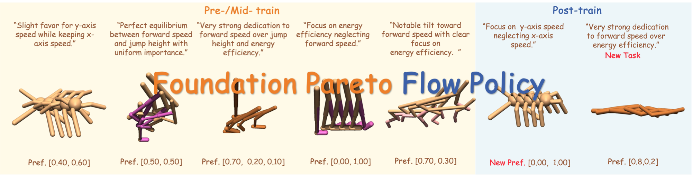
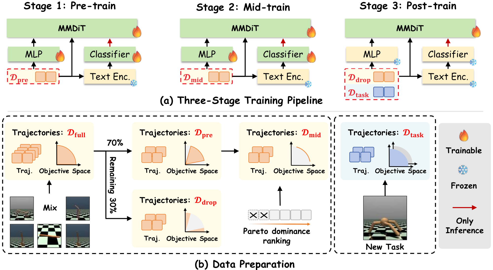

<div align="center">

<h1>FP2: Foundation Pareto Flow Policy<br>for Multi-Objective Reinforcement Learning</h1>

<!-- TODO: add paper / project-page badges once public -->
<p>


<a href="LICENSE"></a>
</p>

<p></p>

</div>

**FP2** is a rectified-flow policy for offline multi-objective RL. A single model covers the whole Pareto front of a
continuous-control task and is steered by a numerical preference or a natural-language instruction. Like a foundation
model, it is pre-trained on large and imperfect data, mid-trained on high-quality Pareto-optimal trajectories, and
post-trained on a few trajectories of unseen preferences or tasks.

## Installation

Dependencies are managed with [uv](https://docs.astral.sh/uv/), which installs Python 3.9 and the pinned packages
from `uv.lock`:

```bash
git clone https://github.com/Fibonaccirabbit/FP2.git && cd FP2
uv sync
source .venv/bin/activate
```

The MO-MuJoCo environments also need [MuJoCo 2.1.0](https://github.com/deepmind/mujoco/releases/tag/2.1.0) in
`~/.mujoco/mujoco210`; `source scripts/env.sh` sets the library path.

## Data

Download the D4MORL datasets from [PEDA](https://github.com/baitingzbt/PEDA) and place them as

```
data
├── MO-Ant-v2
│   ├── MO-Ant-v2_50000_amateur_uniform.pkl
│   └── MO-Ant-v2_50000_expert_uniform.pkl
├── MO-HalfCheetah-v2
├── MO-Hopper-v2
├── MO-Hopper-v3
├── MO-Swimmer-v2
└── MO-Walker2d-v2
```

then check them and cache the text embeddings of all preference prompts:

```bash
python scripts/prepare_data.py
```

## Training

<p align="center"></p>

FP2 is trained in three stages, each starting from the previous one. `--split` selects the preferences held out
from pre- and mid-training: `shattered` (interior regions), `narrow` (both extremes) or `full` (none).

```bash
# Stage 1: pre-training on all retained trajectories
python scripts/run_fp2.py --dataset MO-Hopper-v2_50000_expert_uniform --split shattered --stage 1
# Stage 2: mid-training on the top-two Pareto fronts
python scripts/run_fp2.py --dataset MO-Hopper-v2_50000_expert_uniform --split shattered --stage 2
# Stage 3: post-training on the Pareto front of the held-out preferences
python scripts/run_fp2.py --dataset MO-Hopper-v2_50000_expert_uniform --split shattered --stage 3
```

or all three at once with `bash scripts/train_fp2.sh <dataset> <split>`. The three runs are saved to
`results/fp2/<split>/<dataset>/` as `fp2_s0`, `fp2_s0_mid` and `fp2_s0_ft`. The settings of each stage are in [scripts/run_fp2.py](scripts/run_fp2.py#L24-L38) and can be
overridden with flags such as `--lr` or `--n_gradient_steps`.

For cross-task transfer, FP2-Fou is pre- and mid-trained on five tasks and post-trained on the held-out sixth:

```bash
bash scripts/train_fp2_fou.sh MO-Swimmer-v2
```

## Evaluation

Roll out a trained policy across the Pareto front and report hypervolume, sparsity and preference alignment:

```bash
bash scripts/eval_fp2.sh MO-Hopper-v2_50000_expert_uniform shattered fp2_s0_mid
```

## Citation

```bibtex
@inproceedings{yang2026fp2,
  title     = {Foundation Pareto Flow Policy for Multi-Objective Reinforcement Learning},
  author    = {Yang, Zhanjiang and Sun, Lijun and Li, Yueming and Li, Meng and Yang, Yijun},
  booktitle = {Advances in Neural Information Processing Systems},
  year      = {2026}
}
```

## Acknowledgements

The flow model builds on [CleanDiffuser](https://github.com/CleanDiffuserTeam/CleanDiffuser), and the environments
and datasets come from [PEDA](https://github.com/baitingzbt/PEDA). This code is released under the
[MIT License](LICENSE); see [licenses/](licenses) for the licenses of adapted code.
